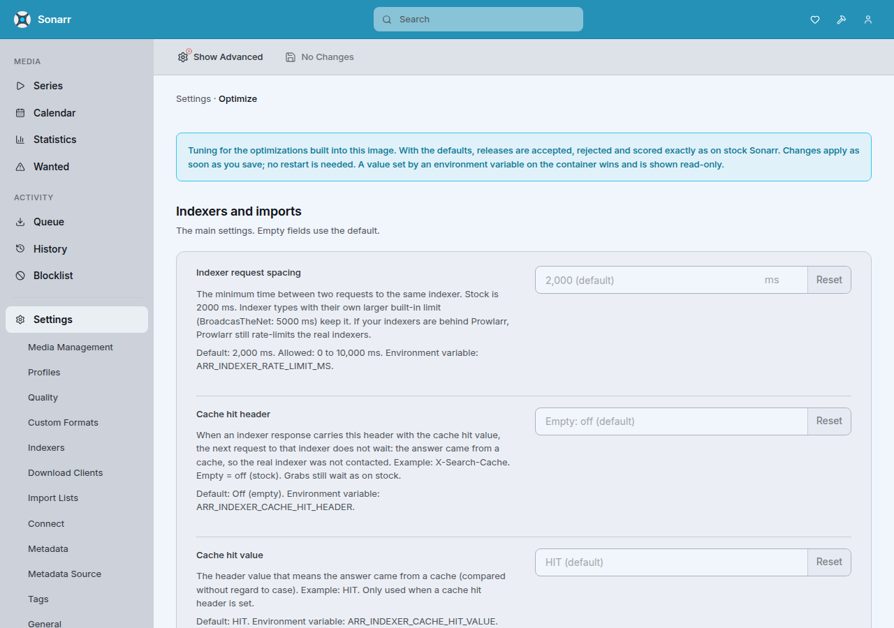

# arr-optimized

Drop-in [Sonarr](https://github.com/Sonarr/Sonarr) and [Radarr](https://github.com/Radarr/Radarr)
images that make release decisions (interactive search, automatic search, RSS sync) faster
**without changing the decision logic**. Given the same inputs, the same releases are accepted or
rejected for the same reasons, with the same custom formats and scores, as stock.

They also carry a few fixes for known upstream bugs outside the decision path (stuck imports, hung
ffprobe runs, duplicate extra-file rows, a scheduler that can stop after an in-app restart, and on
Radarr, database restore and housekeeping safety). Release decision logic is unchanged; with the
same inputs, decisions are identical. Where a fix changes normal operation or the media info that
decisions later use (ffprobe result cache and timeout, Radarr's exclusive housekeeping), this is
listed below. A new **Settings > Optimize** page shows every optimization with its value and
counters, and lets you tune them. With its defaults, requests and grabs are timed exactly as on
stock. See [What changes](#what-changes).

Each image is the stock [linuxserver.io](https://www.linuxserver.io/) image for one upstream
release, pinned by digest, with three parts replaced: the app's `*.Core.dll`, its `*.Api.V3.dll`
(which serves the Optimize page's API) and the web UI folder (`bin/UI`), all built from upstream
source plus the patches in this repository. Every other assembly and everything else (s6 init,
`PUID`/`PGID`, `/config`, ports, mods) is the linuxserver image you already know.

| Image | Upstream | Base |
|---|---|---|
| `ghcr.io/4eh5xitv6787h645ebv/sonarr-optimized:5.0.0.3041` | Sonarr v5 (develop) `5.0.0.3041` | `lscr.io/linuxserver/sonarr:5.0.0.3041-ls212` |
| `ghcr.io/4eh5xitv6787h645ebv/radarr-optimized:7.0.3.10918` | Radarr `7.0.3.10918` | `lscr.io/linuxserver/radarr:7.0.3.10918-ls328` |

`<version>` and `latest` point at the newest build of each. Every build is also published under an
immutable per-commit tag, `<version>-<short commit>` (for example `5.0.0.3041-1a2b3c4`, the first
seven characters of this repository's commit), which is never overwritten. Both images are
`linux/amd64` and `linux/arm64`.

## Using it

Swap the image in your existing container. Keep every volume, port, environment variable and
network the same.

```yaml
services:
  sonarr:
    image: ghcr.io/4eh5xitv6787h645ebv/sonarr-optimized:5.0.0.3041   # was lscr.io/linuxserver/sonarr
  radarr:
    image: ghcr.io/4eh5xitv6787h645ebv/radarr-optimized:7.0.3.10918  # was lscr.io/linuxserver/radarr
```

**Back up `/config` first** (stop the app, copy the folder). Moving to a newer Sonarr or Radarr
version migrates its database, and it cannot be downgraded afterwards without that backup. In
particular, Radarr 6 → 7 is a one-way database upgrade. The Sonarr image is the v5 (develop) line,
so it suits setups that already run Sonarr v5 or want to.

A later build of the same upstream version replaces `:<version>` and `:latest` on your next pull.
To stay on one build, use its per-commit tag (the package page on GitHub lists them):

```yaml
    image: ghcr.io/4eh5xitv6787h645ebv/sonarr-optimized:5.0.0.3041-1a2b3c4   # one build, never replaced
```

To roll back to an earlier build of the same version, switch to that build's per-commit tag. Values
saved on the Optimize page stay in the database; a build that does not know a value ignores it and
uses its own default.

To go back to stock, switch to the linuxserver image of the **same version**. The database format
is identical, since the patches don't touch it. Values saved on the Optimize page are ordinary rows
in the app's `Config` table (keys starting with `optimize`), which stock ignores.

## What changes

### Faster release decisions (identical decisions)

Both apps re-run the same work for every release in a search: custom-format matching (hundreds of
regexes per release) and repeated database reads of the same rows. The patches remove that
repetition and keep every result live:

- **Custom-format match cache.** Remembers *which* custom formats match a given release input.
  The key holds every value the supported condition types read, definitions are checked on every
  call (edits apply immediately), and unknown condition types bypass the cache. Scores and all
  accept/reject decisions are still computed live. Up to 50,000 entries with a 6-hour expiry that
  resets on every use. Typical memory use is about 20–25 MB.
- **Per-search read memo.** Rows that every release re-reads (indexer, and in Sonarr also release
  profiles, history, blocklist and episode rows) are read once per decision batch and re-read
  after any write to that table, so downloads that finish mid-search are seen exactly as on stock.
- **Sonarr only:** blocklist title checks within a batch use an in-memory copy of SQLite's own
  `LIKE` rules (checked against real SQLite with 2.3 million random comparisons, 0 differences).

### Other speed-ups (same results as stock)

- **Statistics.** Series and movie statistics match each season or movie to its file totals with a
  lookup instead of a scan of the whole list. Same numbers, about 3–6× faster on large libraries.
- **Sonarr history page total.** On SQLite, the total of an unfiltered history page is counted
  without joining the series and episode tables (22 ms → 2.6 ms at 50,000 rows). It is exactly the
  stock total, also while deleted episodes still have history rows. Filtered pages and PostgreSQL
  use the stock query.
- **Radarr release profiles and indexer settings.** Release profiles are kept in memory and reloaded
  after every add, edit or delete. Callers get copies, as stock read new objects every time. The
  settings type of an indexer is looked up once instead of scanning every type in Radarr.Core for
  every row.
- **ffprobe results.** Media info for a file that has not changed (same size, modification time
  and, for a symlink, the same final target and its modification time) is reused instead of
  running ffprobe again: an import now probes each file once instead of two or three times. At most
  1,000 files and about 32 MB. Importing, deleting or renaming a file drops its cached result, so an
  upgrade at the same path is probed again even when "Change File Date" gives it the old file's
  date. A file rewritten in place by another program with the same size and modification time
  keeps the old media info.

### Bug fixes

- **Hung or very slow ffprobe.** All ffprobe runs for one file (up to three: the main probe, a
  longer probe when the audio channel layout is missing, and the frame probe for HDR) share one
  time limit, 15 minutes by default (Optimize page, or `ARR_FFPROBE_TIMEOUT_MINUTES`; 0 turns it
  off). When it runs out, the running ffprobe is stopped, an error is logged ("ffprobe did not
  finish within ... and was stopped") and the file gets no media info, instead of the import (and
  the command thread) waiting forever. Without media info most files are not imported
  automatically ("Unable to determine if file is a sample"); the download stays in the queue and is
  retried. A
  failed probe of a file whose newest write is at least a minute old is not repeated for 10 minutes
  (with the ffprobe cache on), so an unchanged file is probed at most once per 10 minutes. With the
  limit set to 0, ffprobe is called exactly as on stock, with no limit.
- **Imports stuck in "Importing".** If an automatic import throws an error, the download goes back to
  "import pending" and is retried on the next check (about once a minute) instead of staying stuck
  until the app restarts. There is no back-off: a permanent error is retried every minute, quietly
  after the first warning.
- **Sonarr: downloads with no matched episodes.** A download whose episodes were all removed or
  renumbered is no longer marked as imported (and so is no longer removed from the download client
  when nothing was imported).
- **Radarr: lost movie link.** A finished download whose movie link was lost is completed with the
  movie from its import results or its history, instead of failing with an error.
- **Scheduler after an in-app restart.** Restarting from the UI or API, a restore, or a setting that
  needs a restart restarts the app inside the same process. Stock then keeps the old scheduler's
  timer handler too, and after a few restarts scheduled tasks (RSS sync, backups, housekeeping) can
  stop running. Each scheduler now has its own timer that is stopped on shutdown.
- **Duplicate extra files.** Replacing an `-orig` metadata file no longer leaves a duplicate row in
  the database (which later made some extra-file lookups fail). A daily housekeeping task removes
  existing duplicates and keeps the newest row per file.
- **Radarr: restore and housekeeping.** A restore upload must be a Radarr database or a valid
  `config.xml`; anything else (for example `logs.db`) is rejected with an error instead of
  replacing the live database. The previous database is kept as `radarr.db.pre-restore*` until the
  app has started on the restored one. Housekeeping (with its database `VACUUM`) waits until no
  other command is running, for at most 30 minutes, and never holds up other commands while it
  waits; commands queued while it runs start after it. After 30 minutes it runs alongside the other
  commands, as on stock.

### Settings > Optimize



A new page under **Settings > Optimize** (`/settings/optimize`, also a card on the Settings page)
lists every optimization in this image. It is built from the app's own settings components and
works in light and dark mode and at phone width.

- **Main settings:** indexer request spacing, cache-hit header and value, and the ffprobe time limit.
- **Advanced tuning:** grab spacing, the custom-format cache, the per-search read memo, the ffprobe
  result cache (size, memory and lifetimes) and, on Radarr, the release-profile cache. Each field
  shows its default and allowed range, warns in its risky range and has a Reset button.
- **All optimization settings:** every value, including the read-only ones, with the value in
  effect, the default, where it comes from (default, saved on this page, environment variable,
  fixed in this build, or a stock setting of the app) and how to change it.
- **Status:** which built-in optimizations are on, and counters since start-up (cache hits and
  misses, ffprobe probes and timeouts, requests that waited or were refunded).

How values are chosen, for each value on its own: a valid **environment variable** wins and the
field is shown read-only; otherwise the value **saved on the page**; otherwise the **default**. An
invalid environment variable is ignored with one warning in the log and shown as an error under its
field. A saved value applies **as soon as you press Save**, without a restart, and is kept across
restarts. With every default, indexer requests and grabs are timed exactly as on stock, and release
decisions are the same as on stock. ffprobe runs are not exactly as on stock: by default all
ffprobe runs for one file share a 15-minute time limit (stock has no limit; 0 turns it off), the
result of an unchanged file is reused from the ffprobe cache, and a failed probe of a file that has
not been written for a minute is not repeated for 10 minutes (see [Bug fixes](#bug-fixes)).

Both apps have the same page, the same environment variable names and the same bounds, so one
`.env` can serve both containers. Two rows exist in one app only, because the code they tune
exists only there.

| Setting | Environment variable | Default | Allowed |
|---|---|---|---|
| Indexer request spacing | `ARR_INDEXER_RATE_LIMIT_MS` | 2000 ms (stock) | page 0–10000 ms, variable 0–86400000 ms |
| Cache hit header | `ARR_INDEXER_CACHE_HIT_HEADER` | empty = off (stock) | an HTTP header name, up to 256 characters |
| Cache hit value | `ARR_INDEXER_CACHE_HIT_VALUE` | `HIT` | one value without `,` or `;`, up to 256 characters |
| ffprobe time limit | `ARR_FFPROBE_TIMEOUT_MINUTES` | 15 min (stock: none) | 0–1440 (0 = no limit, as stock) |
| Grab spacing | `ARR_GRAB_SPACING_MS` | 2000 ms (stock) | 0–60000 ms |
| Custom-format cache entries | `ARR_CF_CACHE_CAPACITY` | 50000 | 0–1000000 (0 = off) |
| Custom-format cache lifetime | `ARR_CF_CACHE_LIFETIME_MINUTES` | 360 min | 1–10080 |
| Custom-format cache input limit | `ARR_CF_CACHE_MAX_KEY_CHARS` | 4096 characters | 256–65536 |
| Custom-format cache sweep (Sonarr only) | `ARR_CF_CACHE_SWEEP_SECONDS` | 60 s | 1–3600 |
| Per-search read memo | `ARR_DECISION_MEMO_ENABLED` | on | on/off (also true/false, yes/no, 1/0) |
| Release-profile cache (Radarr only) | `ARR_RELEASE_PROFILE_CACHE` | on | on/off |
| ffprobe cache entries | `ARR_FFPROBE_CACHE_CAPACITY` | 1000 | 0–100000 (0 = off) |
| ffprobe cache memory | `ARR_FFPROBE_CACHE_MAX_MB` | 32 MB | 0–1024 (0 = off) |
| ffprobe largest result | `ARR_FFPROBE_CACHE_MAX_ENTRY_KB` | 4096 KB | 1–131072, never more than the cache memory |
| ffprobe idle lifetime | `ARR_FFPROBE_CACHE_IDLE_MINUTES` | 360 min | 1–10080 |
| ffprobe failure lifetime | `ARR_FFPROBE_CACHE_FAILURE_MINUTES` | 10 min | 0–10 (0 = not remembered) |
| ffprobe settle time | `ARR_FFPROBE_CACHE_SETTLE_SECONDS` | 60 s | 60–3600 |
| ffprobe recently-written lifetime | `ARR_FFPROBE_CACHE_UNSETTLED_SECONDS` | 60 s | 0–60 (0 = not reused) |
| ffprobe cache sweep | `ARR_FFPROBE_CACHE_SWEEP_SECONDS` | 60 s | 1–3600 |

The ffprobe failure lifetime, settle time and recently-written lifetime can only be made stricter
than their defaults: the cache recognises a file by its size and modification time, and a file
written less than a minute ago can still change without either changing. An environment variable
outside its range is ignored with a warning (the page or the default applies), in both apps. Turning
a cache off (0 or off) runs the stock code path for it. Each app's README describes every row:
[sonarr/README.md](sonarr/README.md#settings--optimize-patch-0011),
[radarr/README.md](radarr/README.md#settings--optimize-patch-0009).

The page uses `GET`/`PUT /api/v3/config/optimize` (plus `GET .../settings`, every value with its
source, and `GET .../status`), with the same API key as every other endpoint. The API is the same in
both apps:

- `GET` returns each value that is saved or set by an environment variable; a number or text that
  follows its default is left out of the JSON (`null`). On/off values are always returned.
- `PUT` changes only the values present in the body. A value left out keeps its saved value; an
  explicit `null` resets it to the default. The page's Reset button sends `null` (for an on/off
  value, its default, which also resets it).
- Values set by an environment variable are locked: `PUT` ignores them, also a `null`.
- Invalid values give HTTP 400 with one error per field.

### Optional: shorter wait between indexer requests (off by default)

Both apps wait 2 seconds between requests to the same indexer. If your indexers allow more (for
example a local Prowlarr, or a caching proxy in front of your indexers), you can lower that wait on
the Optimize page or with environment variables:

```yaml
services:
  sonarr:
    image: ghcr.io/4eh5xitv6787h645ebv/sonarr-optimized:5.0.0.3041
    environment:
      - ARR_INDEXER_RATE_LIMIT_MS=500             # wait between requests to one indexer (stock: 2000)
      - ARR_INDEXER_CACHE_HIT_HEADER=X-Cache      # optional: header your caching proxy sets
      # - ARR_INDEXER_CACHE_HIT_VALUE=HIT         # value that means "served from cache" (default HIT)
```

- `ARR_INDEXER_RATE_LIMIT_MS` (0 to 86400000; 0 to 10000 on the page) applies to indexer types that
  don't set their own limit. Types with their own limit (for example BroadcasTheNet or
  PassThePopcorn) keep it. On Radarr, TorrentPotato (which fixed 2 s) follows the setting.
- `ARR_INDEXER_CACHE_HIT_HEADER`: a response with this header set to `HIT` (or the value you set)
  was answered by your cache, so the next request to that indexer does not wait for it. Grabs
  still wait as on stock. The cache-hit value also applies when the header is set on the page.
- Grabs (downloading the `.torrent`/`.nzb`) from one host stay at least 2 seconds apart, as on
  stock, unless you change the grab spacing.
- An invalid value is logged as a warning and ignored. When a setting is active, the app logs it
  once, at the first indexer request or grab (an indexer Test from the settings page counts as a
  request).
- Lowering the wait for an indexer that you reach directly can get you rate-limited (HTTP 429) by
  that indexer, and so fewer results. Only lower it for indexers that allow it.

With none of these set, requests and grabs are timed exactly as on stock.

### What was removed

Sonarr patch `0002` (cache `Database.DatabaseType`) is gone. It had no effect in the running app,
because the database object the app uses already reads the type once at startup.

Details, rebase notes and the per-patch risk are in [sonarr/README.md](sonarr/README.md) and
[radarr/README.md](radarr/README.md).

## Results

Measured in an offline lab against a copy of a real library, with indexer responses replayed
from a cache so stock and patched builds see identical input. The timings below were measured on the
previous build of this series (next3), before the Optimize page. The Optimize page patches changed
decision-path cache code so that it reads its limits live and can be turned off (the custom-format
cache in both apps, Sonarr's per-batch read memo, Radarr's indexer memo and release-profile cache);
with the defaults the limits are the same constants as in next3. The timings were not measured
again; the decision equivalence was (below).

| | Stock | Patched |
|---|---|---|
| Sonarr, decision CPU over 30 searches | 54.9 s | 12.4 s (−77%) |
| Sonarr, full-season search | 11.4 s | 1.6 s |
| Radarr, interactive movie search | 5.5–9.7 s | 4.1–8.7 s (−11 to −25%) |
| Radarr, RSS sync | 0.8 s | 0.6 s |

Small searches gain less wall time than CPU time, because both apps deliberately wait about 2 s
between requests to the same indexer. That limit is unchanged unless you set
`ARR_INDEXER_RATE_LIMIT_MS` or `ARR_INDEXER_CACHE_HIT_HEADER` (or the same values on the Optimize
page). With them, in the same lab (seven replayed indexers, medians of three runs):

| | Stock | Patched, nothing set | Cache header, hit | Cache header, miss | `ARR_INDEXER_RATE_LIMIT_MS=200` |
|---|---|---|---|---|---|
| Sonarr, 40 episode searches in a row | 398 s | 398 s | 8.7 s | 398 s | 39.8 s |
| Sonarr, one season search | 30.1 s | 20.3 s | 2.6 s | 20.6 s | 4.1 s |
| Radarr, 27 interactive movie searches | 100.6 s | 88.9 s | 28.7 s | 88.0 s | 31.8 s |
| Radarr, automatic search of 40 movies | 178.0 s | 170.2 s | 30.0 s | 170.4 s | 38.1 s |

- With nothing set, and on cache misses, the waits are the same as stock; the remaining difference
  is decision CPU time. RSS sync sends one request per indexer, so it never waits and does not change.
- These are best cases. The lab cache answers in milliseconds, and in the hit column every response
  is marked as a hit. A real cache hit still has network latency, and a miss waits for the indexer.
- The lab has no download client, so grabs were not exercised there. Grab spacing is covered by
  the unit tests, including several grabs from one host that start at the same time.

Equivalence: every decision (accepted/rejected, rejection reasons, custom formats, score, order)
was compared field by field with stock, using the images built from this repository:

- Sonarr, next3: 30 searches (13,716 releases) and two RSS syncs (1,368 decisions), identical with
  nothing set and with both variables set. Current series (next4, with the Optimize page), nothing
  set: the same 30 searches (13,716 releases) and both RSS feeds (1,368 decisions), identical.
- Radarr, next3: 27 movie searches and RSS, two passes (10,526 decisions), identical with nothing
  set, with the cache header, and with `ARR_INDEXER_RATE_LIMIT_MS=200`. Current series (next4),
  nothing set: 27 movie searches and RSS, two passes (56 comparisons, 10,678 decisions), identical.

The next4 runs used the images built before the last review fixes (the Radarr ffprobe cache bounds,
the `PUT` reset semantics, and texts and labels on the page); those fixes change no decision code.

The decision code does not read the rate-limit settings; they only change when indexer requests and
grabs are sent. The other patches don't change what the decision code computes (Radarr's in-memory
release profiles are the same rows, reloaded after every change; upstream's decision-engine and
custom-format tests pass unchanged). The cache settings on the Optimize page only decide how much is
cached and for how long: the tests compare custom-format matches with the stock evaluation at the
smallest, default and largest values and while the values change, and a cache that is turned off
runs the stock code path.

Tests: upstream's full core test suite runs on the patched source with every fixture from this
repository added (filter as in CI: upstream's categories plus the `[Explicit]` benchmarks). Every
full run of this release:

| Run | Sonarr core | Radarr core |
|---|---|---|
| Stock (no patches, no fixtures) | 5,725 passed, 27 skipped, 0 failed | 4,173 passed, 26 skipped, 0 failed |
| Integration of the Optimize page | 6,117 passed, 28 skipped, 0 failed | 4,676 passed, 26 skipped, **1 failed** |
| Two more fixtures; repair run and re-verification run | 6,118 passed, 28 skipped, 0 failed (both) | 4,681 passed, 26 skipped, 0 failed (both) |
| Final tree (this commit: review fixes and their tests) | 6,119 passed, 28 skipped, 0 failed | 4,691 passed, 26 skipped, 0 failed |

The one failure was a wall-clock timing check, `IndexerRateLimitTimingFixture`
(`concurrent_requests_should_keep_reserved_slot("HIT",0.0)`), which measured 1.87 s where 1.9–3.0 s
was allowed while image builds loaded the machine; its fixture passed three reruns and every later
full run. Upstream's API tests with the Optimize controller fixtures: Sonarr 47 passed, Radarr 42
passed (39 before the `PUT` reset tests). Container wiring (`*.Host.Test`): Sonarr 24 passed and 4
skipped, Radarr 23 passed and 5 skipped. The runners in `*/tests` pass against the final DLLs. Each
bug fix has a regression test that fails on stock and passes with the patch.

## Building it yourself

```sh
cd sonarr && ./build.sh --image      # or: cd radarr && ./build.sh
```

`build.sh` clones the pinned upstream tag, refuses to build unless it resolves to the pinned
commit, applies the patches, builds the core and API DLLs with the .NET SDK named in
`upstream.env`, builds the web UI with upstream's own frontend scripts (Node.js 24 and yarn 1;
`YARN="corepack yarn"` works too), and builds the image. The image replaces `*.Core.dll`,
`*.Api.V3.dll` and the `bin/UI` folder of the pinned base image and nothing else. The GitHub
Actions workflow does the same for every push to `main`. It first runs upstream's core, API and
container tests with every fixture from this repository; any failure there stops publishing. The
fixtures that check wall-clock timing over real HTTP or real delays (`IndexerRateLimitTimingFixture`,
`GrabGateHostsFixture`, `OptimizeLiveApplyTimingFixture` in Sonarr, `OptimizeRateLimitLiveFixture`
in Radarr) run in a separate step that is retried once and only warns, because a busy shared runner
can miss their time windows. Then it publishes the images as `<version>`, `<version>-<short commit>`
and `latest`.

## Updating to a new upstream release

Only ever run the DLLs and UI with the base image of the version they were built from. To move to a new
release, update `upstream.env` (tag, commit, base image digest) and the `FROM` line, rebuild, and
run the tests. The rebase notes in each app's README list what to check.

## License

GPL-3.0, the same as Sonarr and Radarr. This is an unofficial build, not affiliated with or
supported by the Sonarr, Radarr or linuxserver.io teams. Please don't report problems from these
images upstream. Reproduce on the stock image first.
